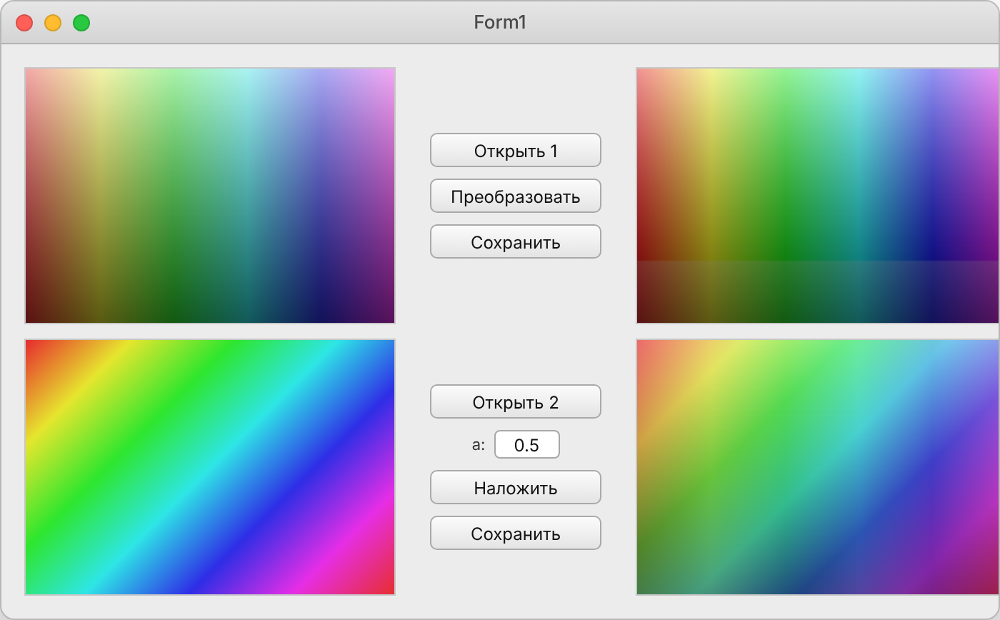

# Лабораторная работа №5. Попиксельные преобразования

**Дисциплина:** Компьютерная графика
**Среда разработки:** Lazarus IDE (Free Pascal Compiler)
**Вариант 1:** Увеличить на 30% насыщенность точек, яркость которых превышает 50%. Наложение — аддитивное.

## Задание

1. Разработать алгоритм и программу для чтения из файла, преобразования и записи в файл графической информации по варианту. Программа включает: чтение пары изображений из файла; попиксельную обработку изображения; наложение одного изображения на другое; сохранение созданных изображений в файл.
2. Ответить на контрольные вопросы.
3. Оформить отчёт.

По варианту: изображение 1 преобразуется в модели **HSV** — у всех точек, яркость (V) которых больше 50%, насыщенность (S) увеличивается на 30% (`S := min(1, S*1.3)`). Отдельно выполняется **аддитивное наложение** изображения 1 на изображение 2: `Cres = a*C1 + b*C2`, где `a+b=1`.

## Программа

Форма содержит:

| Компонент | Имя | Назначение |
|---|---|---|
| TImage | `Image1` | исходное изображение 1 |
| TImage | `Image2` | результат попиксельного преобразования |
| TImage | `Image3` | исходное изображение 2 (для наложения) |
| TImage | `Image4` | результат наложения |
| TButton | `ButtonLoad1` | "Открыть 1" |
| TButton | `ButtonTransform` | "Преобразовать" |
| TButton | `ButtonSaveTransform` | "Сохранить" (результат преобразования) |
| TButton | `ButtonLoad2` | "Открыть 2" |
| TEdit | `EditWeight` | коэффициент `a` для наложения (0..1) |
| TButton | `ButtonOverlay` | "Наложить" |
| TButton | `ButtonSaveOverlay` | "Сохранить" (результат наложения) |
| TOpenPictureDialog | `OpenPictureDialog1` | диалог открытия файла |
| TSavePictureDialog | `SavePictureDialog1` | диалог сохранения файла |

Ключевой фрагмент — попиксельное увеличение насыщенности по варианту (конверсии RGB↔HSV и остальные обработчики — в полном коде ниже):

```pascal
procedure TForm1.ButtonTransformClick(Sender: TObject);
var
  i, j, w, h: Integer;
  cr, cg, cb: byte;
  hc, sc, vc: real;
  col: TColor;
begin
  if Image1.Picture.Graphic = nil then
  begin
    ShowMessage('Сначала загрузите изображение 1!');
    Exit;
  end;

  w := Image1.Picture.Bitmap.Width;
  h := Image1.Picture.Bitmap.Height;

  Image2.Picture.Bitmap.PixelFormat := pf24bit;
  Image2.Picture.Bitmap.SetSize(w, h);

  for j := 0 to h - 1 do
    for i := 0 to w - 1 do
    begin
      col := Image1.Picture.Bitmap.Canvas.Pixels[i, j];
      cr := GetRValue(col);
      cg := GetGValue(col);
      cb := GetBValue(col);

      rgb2hsv(cr, cg, cb, hc, sc, vc);
      if vc > 0.5 then
        sc := Min(1.0, sc * 1.3);
      hsv2rgb(hc, sc, vc, cr, cg, cb);

      Image2.Picture.Bitmap.Canvas.Pixels[i, j] := RGB(cr, cg, cb);
    end;

  Image2.Stretch := True;
  Image2.Proportional := True;
  Image2.Invalidate;
end;
```

<details>
<summary>Показать полный код Unit1.pas</summary>

```pascal
unit Unit1;

{$mode objfpc}{$H+}

interface

uses
  Classes, SysUtils, Forms, Controls, Graphics, Dialogs, ExtDlgs, ExtCtrls,
  StdCtrls, LCLIntf, LCLType, Math;

type

  { TForm1 }

  TForm1 = class(TForm)
    ButtonLoad1: TButton;
    ButtonTransform: TButton;
    ButtonSaveTransform: TButton;
    ButtonLoad2: TButton;
    ButtonOverlay: TButton;
    ButtonSaveOverlay: TButton;
    EditWeight: TEdit;
    Label1: TLabel;
    Image1: TImage;
    Image2: TImage;
    Image3: TImage;
    Image4: TImage;
    OpenPictureDialog1: TOpenPictureDialog;
    SavePictureDialog1: TSavePictureDialog;
    procedure ButtonLoad1Click(Sender: TObject);
    procedure ButtonTransformClick(Sender: TObject);
    procedure ButtonSaveTransformClick(Sender: TObject);
    procedure ButtonLoad2Click(Sender: TObject);
    procedure ButtonOverlayClick(Sender: TObject);
    procedure ButtonSaveOverlayClick(Sender: TObject);
  private
  public
  end;

var
  Form1: TForm1;

implementation

{$R *.lfm}

{ TForm1 }

function ConvertTo24Bit(aValue: TBitmap): TBitmap;
begin
  Result := TBitmap.Create;
  if aValue.PixelFormat <> pf24bit then
  begin
    Result.PixelFormat := pf24bit;
    Result.SetSize(aValue.Width, aValue.Height);
    Result.Canvas.Draw(0, 0, aValue);
  end
  else
    Result.Assign(aValue);
end;

procedure rgb2hsv(cr, cg, cb: byte; out hc, sc, vc: real);
var
  maxa, mina: real;
begin
  maxa := MaxValue([cr, cg, cb]);
  mina := MinValue([cr, cg, cb]);
  vc := maxa / 255;
  if maxa = 0 then
    sc := 0
  else
    sc := 1 - mina / maxa;

  if maxa = mina then
    hc := 0
  else if maxa = cr then
  begin
    hc := 60 * (cg - cb) / (maxa - mina);
    if cg < cb then
      hc := hc + 360;
  end
  else if maxa = cg then
    hc := 60 * (cb - cr) / (maxa - mina) + 120
  else
    hc := 60 * (cr - cg) / (maxa - mina) + 240;
end;

procedure hsv2rgb(hc, sc, vc: real; out cr, cg, cb: byte);
var
  hi: Integer;
  f, p, q, t: real;
  rr, rg, rb: real;
begin
  hi := Trunc(hc / 60) mod 6;
  f := hc / 60 - Trunc(hc / 60);
  p := vc * (1 - sc);
  q := vc * (1 - f * sc);
  t := vc * (1 - (1 - f) * sc);
  case hi of
    0: begin rr := vc; rg := t; rb := p; end;
    1: begin rr := q; rg := vc; rb := p; end;
    2: begin rr := p; rg := vc; rb := t; end;
    3: begin rr := p; rg := q; rb := vc; end;
    4: begin rr := t; rg := p; rb := vc; end;
  else
    begin rr := vc; rg := p; rb := q; end;
  end;
  cr := EnsureRange(round(rr * 255), 0, 255);
  cg := EnsureRange(round(rg * 255), 0, 255);
  cb := EnsureRange(round(rb * 255), 0, 255);
end;

procedure TForm1.ButtonLoad1Click(Sender: TObject);
var
  tmp: TBitmap;
begin
  if OpenPictureDialog1.Execute then
  begin
    Image1.Picture.LoadFromFile(OpenPictureDialog1.FileName);
    if Image1.Picture.Bitmap.PixelFormat <> pf24bit then
    begin
      tmp := ConvertTo24Bit(Image1.Picture.Bitmap);
      Image1.Picture.Bitmap.Assign(tmp);
      tmp.Free;
    end;
    Image1.Stretch := True;
    Image1.Proportional := True;
  end;
end;

procedure TForm1.ButtonTransformClick(Sender: TObject);
var
  i, j, w, h: Integer;
  cr, cg, cb: byte;
  hc, sc, vc: real;
  col: TColor;
begin
  if Image1.Picture.Graphic = nil then
  begin
    ShowMessage('Сначала загрузите изображение 1!');
    Exit;
  end;

  w := Image1.Picture.Bitmap.Width;
  h := Image1.Picture.Bitmap.Height;

  Image2.Picture.Bitmap.PixelFormat := pf24bit;
  Image2.Picture.Bitmap.SetSize(w, h);

  for j := 0 to h - 1 do
    for i := 0 to w - 1 do
    begin
      col := Image1.Picture.Bitmap.Canvas.Pixels[i, j];
      cr := GetRValue(col);
      cg := GetGValue(col);
      cb := GetBValue(col);

      rgb2hsv(cr, cg, cb, hc, sc, vc);
      if vc > 0.5 then
        sc := Min(1.0, sc * 1.3);
      hsv2rgb(hc, sc, vc, cr, cg, cb);

      Image2.Picture.Bitmap.Canvas.Pixels[i, j] := RGB(cr, cg, cb);
    end;

  Image2.Stretch := True;
  Image2.Proportional := True;
  Image2.Invalidate;
end;

procedure TForm1.ButtonSaveTransformClick(Sender: TObject);
begin
  if SavePictureDialog1.Execute then
    Image2.Picture.SaveToFile(SavePictureDialog1.FileName);
end;

procedure TForm1.ButtonLoad2Click(Sender: TObject);
var
  tmp: TBitmap;
begin
  if OpenPictureDialog1.Execute then
  begin
    Image3.Picture.LoadFromFile(OpenPictureDialog1.FileName);
    if Image3.Picture.Bitmap.PixelFormat <> pf24bit then
    begin
      tmp := ConvertTo24Bit(Image3.Picture.Bitmap);
      Image3.Picture.Bitmap.Assign(tmp);
      tmp.Free;
    end;
    Image3.Stretch := True;
    Image3.Proportional := True;
  end;
end;

procedure TForm1.ButtonOverlayClick(Sender: TObject);
var
  i, j, w, h: Integer;
  a, b: real;
  c1, c2: TColor;
  r1, g1, b1, r2, g2, b2: byte;
  rr, rg, rb: byte;
  fs: TFormatSettings;
begin
  if (Image1.Picture.Graphic = nil) or (Image3.Picture.Graphic = nil) then
  begin
    ShowMessage('Сначала загрузите оба изображения (кнопки "Открыть 1" и "Открыть 2")!');
    Exit;
  end;

  fs := DefaultFormatSettings;
  fs.DecimalSeparator := '.';
  if not TryStrToFloat(Trim(EditWeight.Text), a, fs) then
    a := 0.5;
  a := EnsureRange(a, 0, 1);
  b := 1 - a;

  w := Min(Image1.Picture.Bitmap.Width, Image3.Picture.Bitmap.Width);
  h := Min(Image1.Picture.Bitmap.Height, Image3.Picture.Bitmap.Height);

  Image4.Picture.Bitmap.PixelFormat := pf24bit;
  Image4.Picture.Bitmap.SetSize(w, h);

  for j := 0 to h - 1 do
    for i := 0 to w - 1 do
    begin
      c1 := Image1.Picture.Bitmap.Canvas.Pixels[i, j];
      c2 := Image3.Picture.Bitmap.Canvas.Pixels[i, j];
      r1 := GetRValue(c1); g1 := GetGValue(c1); b1 := GetBValue(c1);
      r2 := GetRValue(c2); g2 := GetGValue(c2); b2 := GetBValue(c2);

      rr := EnsureRange(round(a * r1 + b * r2), 0, 255);
      rg := EnsureRange(round(a * g1 + b * g2), 0, 255);
      rb := EnsureRange(round(a * b1 + b * b2), 0, 255);

      Image4.Picture.Bitmap.Canvas.Pixels[i, j] := RGB(rr, rg, rb);
    end;

  Image4.Stretch := True;
  Image4.Proportional := True;
  Image4.Invalidate;
end;

procedure TForm1.ButtonSaveOverlayClick(Sender: TObject);
begin
  if SavePictureDialog1.Execute then
    Image4.Picture.SaveToFile(SavePictureDialog1.FileName);
end;

end.
```

</details>

## Результат работы программы




*Рис. 1 – Слева сверху: исходное изображение 1; справа сверху: результат попиксельного преобразования (насыщенность ярких точек увеличена на 30%, видно усиление цвета в верхней, более яркой части картинки, и отсутствие изменений в тёмной нижней части). Слева снизу: исходное изображение 2. Справа снизу: результат аддитивного наложения изображений 1 и 2 с коэффициентом a=0,5.*

## Как запустить

1. Создать новый проект Application в Lazarus.
2. Разместить на форме компоненты по таблице выше, присвоить им точные имена (свойство Name).
3. Вставить код `Unit1.pas` целиком.
4. Привязать `OnClick` каждой кнопки к соответствующему обработчику.
5. На macOS при ошибке линковщика `ld: malformed method list atom` добавить `-WM10.9` в Project Options → Compiler Options → Custom Options.
6. Запустить (F9): "Открыть 1" → "Преобразовать" → "Открыть 2" → ввести a → "Наложить".

## Вывод

Попиксельное преобразование в модели HSV позволяет изменять насыщенность только тех точек, которые удовлетворяют заданному условию по яркости, не затрагивая остальные пиксели — результат наглядно виден в более ярких (верхних) областях изображения. Аддитивное наложение с коэффициентами, дающими в сумме единицу, позволяет плавно смешивать два изображения без выхода значений каналов за пределы допустимого диапазона.
